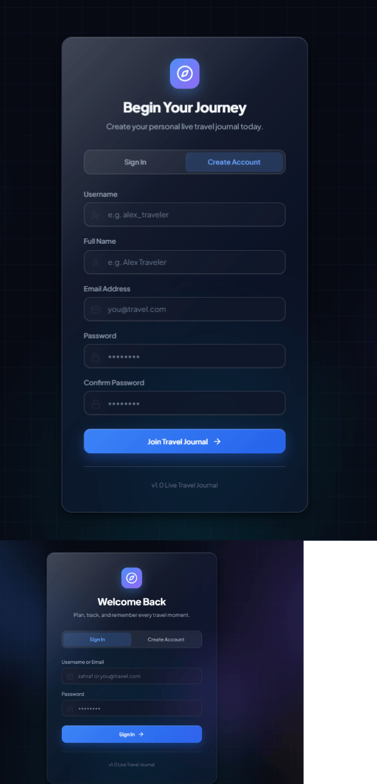
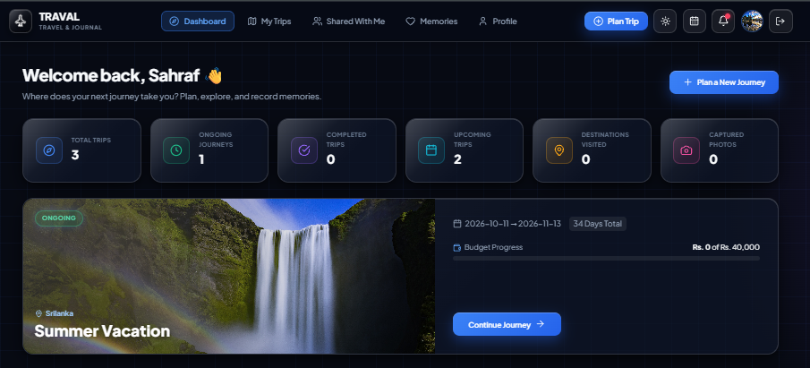
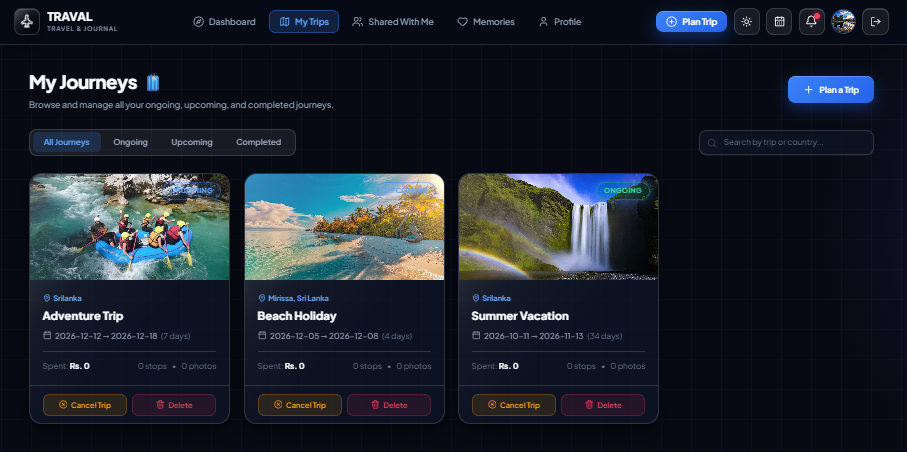
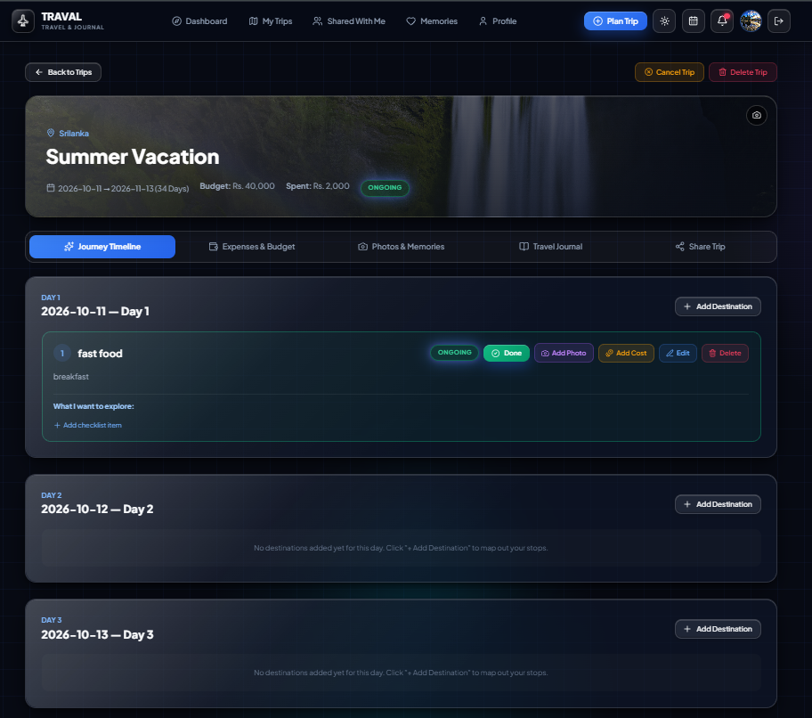
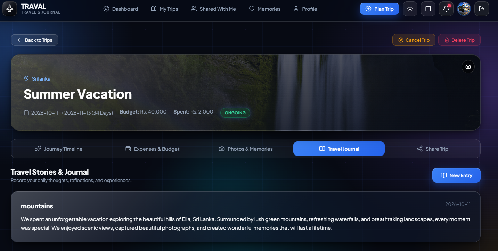
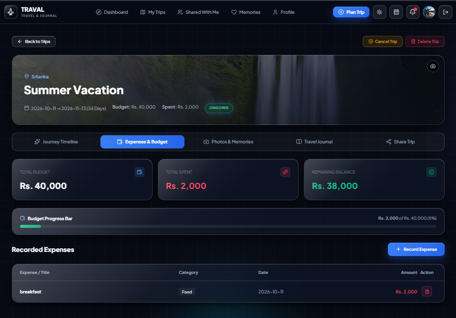
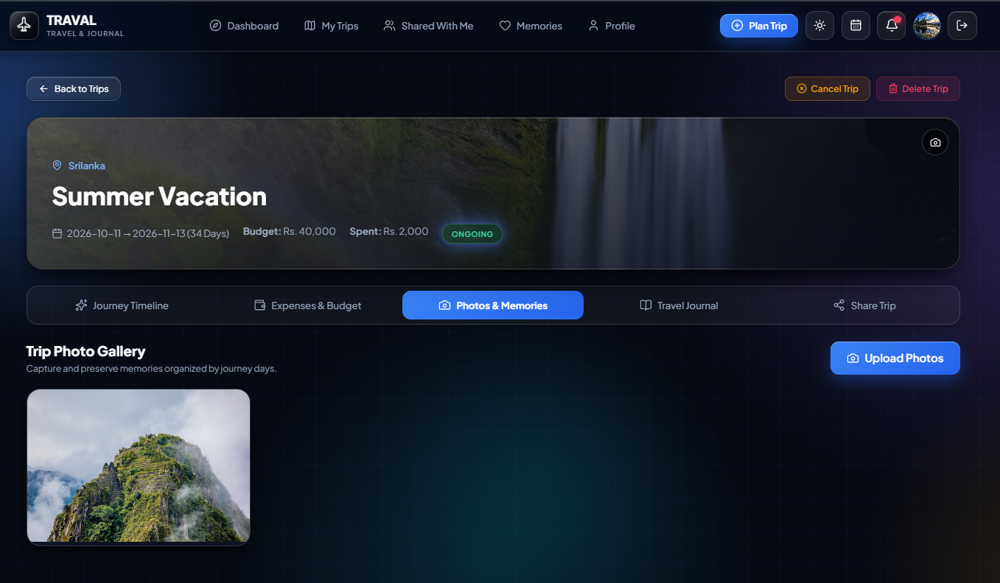
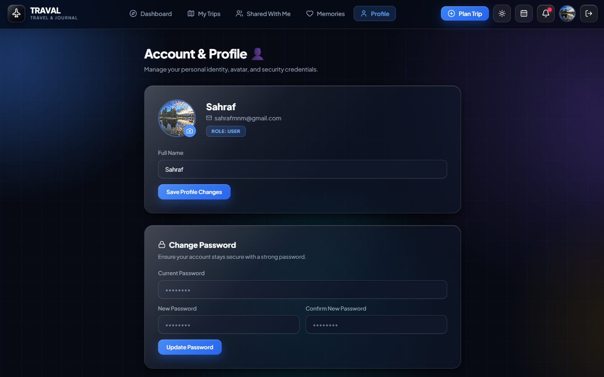
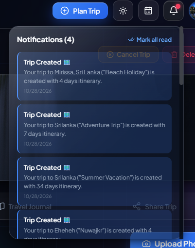
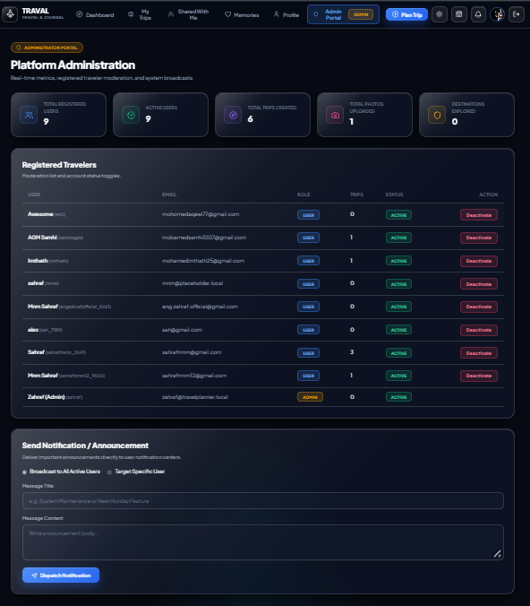

# Travel Planner and Trip Organizer

A full-stack web application for organizing trips and managing travel activities in one place. The system helps users plan trips, manage destinations, track expenses, maintain travel journals, upload photos, and manage travel-related information through a centralized platform.

## Table of Contents

- [Project Overview](#project-overview)
- [Features](#features)
- [Technologies Used](#technologies-used)
- [Project Structure](#project-structure)
- [Prerequisites](#prerequisites)
- [Installation and Setup](#installation-and-setup)
- [Environment Variables](#environment-variables)
- [Database Design](#database-design)
- [API Documentation](#api-documentation)
- [Screenshots](#screenshots)
- [Testing](#testing)
- [Production Build](#production-build)
- [Future Enhancements](#future-enhancements)

## Project Overview

The Travel Planner and Trip Organizer is designed to simplify travel planning by providing a single platform for managing trip information and related activities. It uses a React-based frontend, a Node.js and Express.js backend, and a MySQL database to support application functionality and data persistence.

## Features

- **User Authentication:** User registration, login, and account management.
- **Trip Management:** Create, view, update, and delete trips.
- **Journey Planning:** Organize travel plans and destinations.
- **Expense Tracking:** Record and manage trip-related expenses.
- **Travel Journals:** Document travel experiences and journey entries.
- **Photo Management:** Upload and manage travel photos.
- **Trip Sharing:** Share trip information where supported.
- **Notifications:** Display relevant application notifications.
- **User Profiles:** Manage user profile information.
- **Administrative Functions:** Support administrative operations where implemented.

## Technologies Used

### Frontend

- React
- Vite
- JavaScript
- CSS

### Backend

- Node.js
- Express.js
- JavaScript

### Database and External Services

- MySQL
- Cloudinary for image management
- Email service for authentication-related communication

### Development Tools

- Git
- GitHub
- Visual Studio Code
- Docker, for containerized backend execution where configured

## Project Structure

```text
Travel-Planner-and-Trip-Organizer/
├── frontend/
│   ├── public/
│   ├── src/
│   │   ├── components/
│   │   ├── context/
│   │   └── services/
│   └── package.json
├── backend/
│   ├── src/
│   │   ├── config/
│   │   ├── controllers/
│   │   ├── database/
│   │   ├── middlewares/
│   │   ├── routes/
│   │   ├── services/
│   │   └── utils/
│   ├── Dockerfile
│   └── package.json
└── README.md
```

This is a representative structure. Refer to the actual repository for the complete directory and file list.

## Prerequisites

Install the following software before running the application:

- Node.js and npm
- MySQL Server
- Git
- A modern web browser
- A code editor such as Visual Studio Code

Docker is optional unless you use the project's containerized setup.

## Installation and Setup

### 1. Clone the Repository

```bash
git clone https://github.com/engzahraf/Travel-Planner-and-Trip-Organizer.git
cd Travel-Planner-and-Trip-Organizer
```

### 2. Install Backend Dependencies

```bash
cd backend
npm install
```

### 3. Configure the Database

1. Start the MySQL server.
2. Create the database using the name expected by the backend configuration.
3. Locate the database schema or migration files in `backend/src/database/`.
4. Execute the appropriate schema or migration instructions to create the required tables.
5. Configure the database connection credentials through the project's expected configuration or environment variables.

If the project contains `backend/src/database/schema.sql`, use it to create the tables. Run `seed.js` only if the project provides a seed script and you need its sample data.

### 4. Configure Backend Environment Variables

Create the required `.env` file in the location expected by the backend.

Configure the database credentials, authentication secrets, email service settings, Cloudinary credentials, and any other variables required by the implemented application.

See the [Environment Variables](#environment-variables) section below.

### 5. Start the Backend

Run the script defined in `backend/package.json`.

For example, if a `dev` script exists:

```bash
npm run dev
```

Otherwise, use the actual script defined in the project's `package.json`.

### 6. Install Frontend Dependencies

Open a separate terminal from the project root:

```bash
cd frontend
npm install
```

### 7. Start the Frontend

For a typical Vite project:

```bash
npm run dev
```

Open the local URL displayed in the terminal. It is commonly `http://localhost:5173`, but use the URL provided by your application.

Ensure that the frontend is configured to communicate with the correct backend API address.

## Environment Variables

The application may require environment variables for database access, authentication, email delivery, image management, and frontend-to-backend communication.

Common examples include:

| Variable | Purpose |
|---|---|
| `PORT` | Backend server port |
| `DB_HOST` | MySQL server address |
| `DB_USER` | MySQL username |
| `DB_PASSWORD` | MySQL password |
| `DB_NAME` | Application database name |
| `JWT_SECRET` | Authentication token signing secret, if JWT is used |
| Cloudinary variables | Image storage configuration |
| Email service variables | Authentication-related email delivery |
| Frontend API URL | Backend address used by the frontend |

These are illustrative names, not a guarantee of the variable names used in this project. Check the backend configuration files and existing environment example files for the exact names.

**Security:** Never commit real passwords, API keys, authentication secrets, or private credentials to GitHub. Keep `.env` files excluded through `.gitignore`.

## Database Design

MySQL is used to store and manage the application's structured data.

The database may include entities such as:

- **Users:** Account and profile information.
- **Trips:** Trip details, dates, and ownership information.
- **Destinations:** Places associated with trips.
- **Journey Entries:** Travel journal records.
- **Photos:** Uploaded image references and related metadata.
- **Expenses:** Trip-related costs and expense details.
- **Notifications:** User-specific notification information, if implemented.

The actual tables, attributes, primary keys, foreign keys, and relationships must match the implemented database schema.

### Entity Relationship Diagram (ERD)

The ERD illustrates the database entities and the relationships between them.

Add your generated ERD image to the repository and update the path below to match its actual location.


## API Documentation

The backend uses Express.js routes to handle requests from the frontend.

Document the API endpoints implemented in the application. The following table is a template; replace the example resource names and paths with your actual routes.

| HTTP Method | Purpose |
|---|---|
| `GET` | Retrieve data |
| `POST` | Create a resource or submit data |
| `PUT` / `PATCH` | Update an existing resource |
| `DELETE` | Delete a resource |

For each implemented endpoint, document its path, HTTP method, purpose, authentication requirements, and expected request or response format.

## Screenshots


### Authentication


### Dashboard


### Trip Management


### Trip Details


### Journey Logbook


### Expense Management


### Photo Gallery


### Profile


### Notifications


### Admin Dashboard


These are example image references. GitHub will display them only after the corresponding image files have been committed to the repository.

## Testing

Test the application's main features to verify that they work correctly.

| Test Case | Expected Result |
|---|---|
| User registration and login | Valid account operations complete successfully |
| Create a trip | The trip is saved successfully |
| View trips | Saved trips are displayed |
| Update a trip | Modified details are saved |
| Delete a trip | The selected trip is removed |
| Manage destinations | Destination information is stored and displayed correctly |
| Create a journey entry | The entry is saved and displayed |
| Upload a photo | The supported image upload completes successfully |
| Record an expense | The expense is saved and displayed |
| Submit invalid data | Appropriate validation or error feedback is provided |

Record the actual test results before submission. Do not mark a test as passed unless you have verified it.

## Production Build

To build the frontend for production, run:

```bash
cd frontend
npm run build
```

For a Vite application, the production build is normally generated in `frontend/dist/`.

Follow the backend's actual configuration and deployment instructions when preparing the backend for production.

## Future Enhancements

Possible future improvements include:

- Interactive maps and route planning.
- Weather information for travel destinations.
- Destination recommendations.
- Advanced expense analysis and budget summaries.
- Improved search and filtering.
- Enhanced accessibility and responsive design.
- Additional trip-sharing and collaboration features.

These are proposed enhancements, not claims that the features are already implemented.

## Conclusion

The Travel Planner and Trip Organizer provides a centralized web-based solution for organizing trips and managing travel activities. By combining React, Node.js, Express.js, and MySQL, the project demonstrates full-stack web application development, API-based communication, and relational data management.

The system can be extended with additional functionality to improve the travel planning experience and support more advanced travel management needs.
